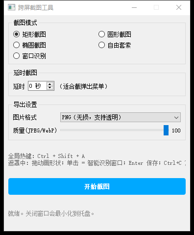
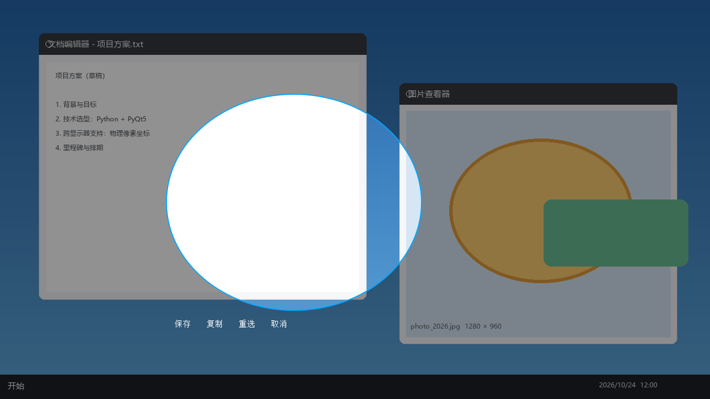

# 跨屏截图工具（CrossScreenCapture）

基于 Python + PyQt5 的 Windows 截图工具，支持多显示器（含不同缩放率的混合 DPI 配置），
全部坐标按物理像素处理，跨屏选区捕获精确对齐。




## 下载使用（免安装）

前往 [Releases](../../releases) 下载 `CrossScreenCapture.exe`，双击即用，无需 Python 环境。

> 单文件 exe 约 58 MB（首次启动需解压，稍等 2~3 秒）；如被杀软误报可选择从源码运行。

## 功能

| 功能 | 说明 |
|------|------|
| 矩形截图 | 任意比例矩形选区，可跨显示器拖拽 |
| 圆形截图 | 正圆选区（1:1 约束） |
| 椭圆截图 | 任意比例椭圆选区 |
| 自由套索 | 按鼠标轨迹圈选，松开自动闭合 |
| 窗口识别 | 自动识别光标下的窗口（含标题提示），单击即捕获 |
| 自定义导出格式 | PNG / JPEG / BMP / WebP / TIFF，JPEG/WebP 可调质量 |
| 复制到剪贴板 | 截图后一键复制，可直接粘贴 |
| 全局热键 | `Ctrl + Shift + A` 随时唤起截图 |
| 延时截图 | 0~10 秒倒计时后自动截图（适合截弹出菜单） |
| 系统托盘 | 关闭面板最小化到托盘，托盘菜单可截图/退出 |

## 从源码运行

```bash
pip install -r requirements.txt
python main.py              # 启动
python main.py --selftest   # 无界面自检（抓屏/窗口识别/遮罩/导出全链路）
```

### 自己打包 exe

```bash
pip install pyinstaller
pyinstaller --onefile --windowed --icon app.ico main.py
# 产物在 dist/ 下
```

## 截图遮罩操作

- **移动鼠标**：高亮光标下的窗口，并显示窗口标题
- **按下拖动**：绘制当前所选形状（可跨显示器）
- **单击不拖**：智能捕获高亮窗口（任何模式下都可用）
- **Enter**：保存　**Ctrl+C**：复制到剪贴板　**Esc**：取消
- 选区完成后弹出工具条：保存 / 复制 / 重选 / 取消

## 实现要点

- 进程以 Per-Monitor DPI Aware V2 运行并禁用 Qt 高分屏缩放，
  Qt 坐标 = Windows 物理像素，与 Win32 API（窗口矩形、光标位置）和抓屏图像 1:1 对应
- 抓屏用 `PIL.ImageGrab.grab(all_screens=True)`，尺寸与虚拟桌面不符时
  自动回退到 ctypes BitBlt 逐屏抓取
- 窗口识别按 Z 序枚举顶级窗口，用 DWM 扩展边框（`DWMWA_EXTENDED_FRAME_BOUNDS`）
  取精确可视边界，自动跳过自身窗口、工具窗口与被遮蔽的 UWP 幽灵窗口
- 异形遮罩 4x 超采样 + LANCZOS 缩放，椭圆/套索边缘平滑抗锯齿
- 全局热键由后台线程 `RegisterHotKey` + 消息循环实现，经 Qt 队列信号安全回调主线程

## 项目结构

```
main.py                  # 入口
app.ico                  # 应用图标
core/
    screen_utils.py      # DPI 感知、虚拟桌面几何、抓屏
    window_detector.py   # Win32 跨屏窗口识别
    capture_overlay.py   # 跨屏全屏遮罩层（选区交互）
    image_exporter.py    # 异形遮罩、多格式导出、剪贴板
    main_window.py       # 控制面板、延时截图、托盘
    global_hotkey.py     # 全局热键
    selftest.py          # 自检
```

## 已知限制

- 混合缩放率的多显示器上，跨屏遮罩层的预览画面会被系统做视觉拉伸
  （仅影响预览观感，捕获坐标与成图仍按物理像素精确）
- JPEG / BMP 不支持透明通道，异形截图（圆/椭圆/套索）导出这两种格式时自动铺白底
- 剪贴板中的透明通道在少数不支持 alpha 的应用里粘贴后可能显示为黑底，
  此类场景建议保存为 PNG
